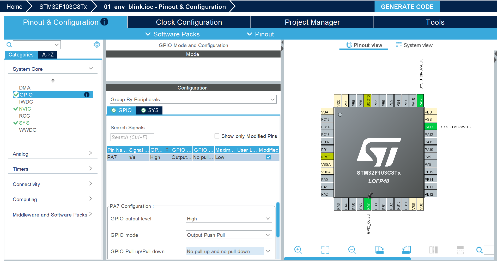
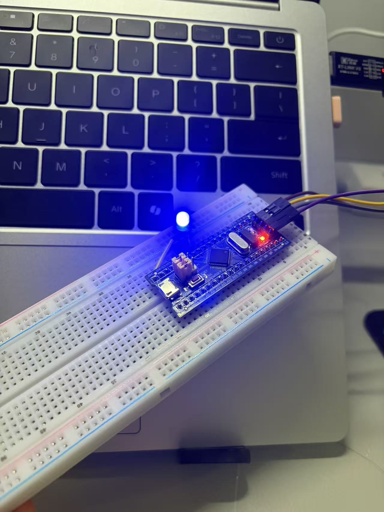

一、工程配置笔记：

芯片型号：STM32F103C8T6

系统时钟：配置为72MHz

开发环境：Makefile+ARM GCC+Vscode

烧录工具：STM32CubeProgrammer+ST-link

二、引脚配置：

PA7 -> GPIO_Output(推挽输出) -> 驱动LED常亮

PA13 -> SYS_JIMS-SWDIO -> ST-Link调试数据线

PA14 -> SYS_JTCK-SWCLK -> ST-Link调试时钟线

三、编译与烧录：

编译：终端输入make

连接ST-Link与板子

烧录：终端输入make flash

工程配置和最终效果如下

