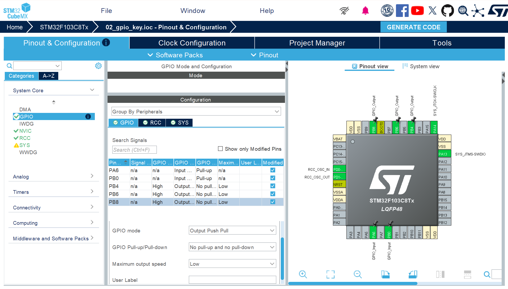

一�工程�置笔记：

芯片��：STM32F103C8T6

系统时钟：�置为72MHz

开��境：Makefile+ARM GCC+Vscode

烧录工具：STM32CubeProgrammer+ST-link

二�引脚�置：

PA13 -> SYS_JIMS-SWDIO -> ST-Link调试数��

PA14 -> SYS_JTCK-SWCLK -> ST-Link调试时钟�

PA6 -> GPIO-Input -> 读�按键状�

PB0 -> GPIO-Input -> 读�按键状�

PB4 -> GPIO-Output -> 输出高�电平

PB6 -> GPIO-Output -> 输出高�电平

PB8 -> GPIO-Output -> 输出高�电平

三�编译�烧录�

编译：终端输入make

��ST-Link���

烧录：终端输入make flash

工程�置如下

最终效��附件

- [LED ·­×ªÑİʾ](https://github.com/Happy-19/LightChaser-Training-71/releases/download/v1.0/LEDchange.mp4)
- [³¤°´Óë¶Ì°´Ñİʾ](https://github.com/Happy-19/LightChaser-Training-71/releases/download/v1.0/twopress.mp4)