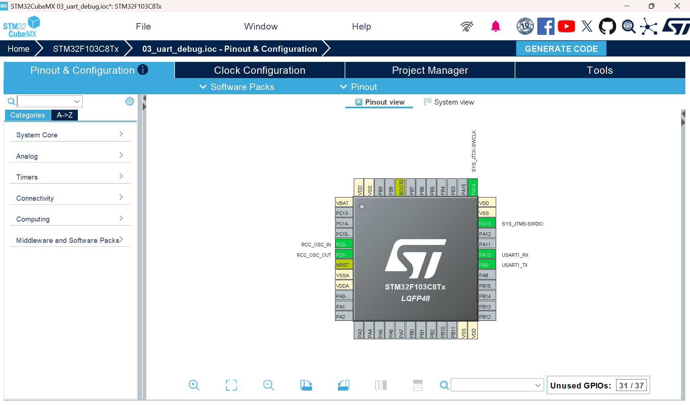
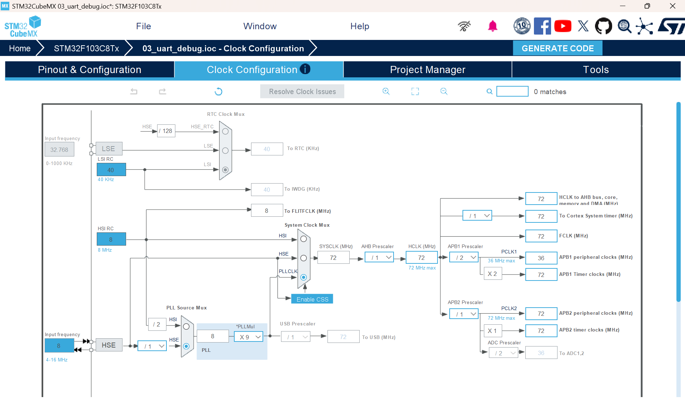

一、工程配置笔记：

芯片型号：STM32F103C8T6

系统时钟：配置为72MHz

开发环境：Makefile+ARM GCC+Vscode

烧录工具：STM32CubeProgrammer+ST-link

二、引脚配置：

PA13 -> SYS_JIMS-SWDIO -> ST-Link调试数据线

PA14 -> SYS_JTCK-SWCLK -> ST-Link调试时钟线

PA10 -> USART1_RX -> 单片机接收端

PA9 -> USART1_TX -> 单片机发送端

其余引脚不接线不列出

三、编译与烧录：

编译：终端输入make

连接ST-Link与板子

烧录：终端输入make flash

工程配置如下

时钟配置如下

单片机发送、打印和回显的演示见附件
https://github.com/Happy-19/LightChaser-Training-71/releases/download/v1.0/03_uart_debug_.mp4